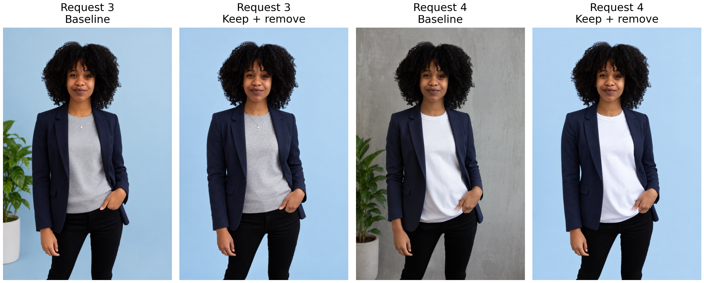

# 반복 인물 이미지 편집을 위한 유지 및 삭제 지시의 상태 갱신 제약

Explicit Preservation and Removal Constraints for State Updates in Iterative Portrait Editing

저자: 김미르, 장윤석

지도교수: 안남혁

## 초록

반복 이미지 편집에서는 변경할 내용과 유지하거나 삭제할 내용을 다음 프롬프트에 정확히 반영해야 한다. 본 연구는 언어 모델이 변경 사항을 추출하고 재검토한 뒤 명시적인 유지·삭제 지시를 확인하는 후처리 규칙을 제안한다. 유지 규칙은 이전 값을 보존하고 삭제 규칙은 값을 없음으로 설정한다. 유지·삭제 규칙 비교 실험의 대화 8개 32턴에서 전체 상태 일치율은 기준 27/32, 유지 규칙만 27/32, 삭제 규칙만 28/32, 두 규칙 결합 29/32였다. 새로운 대화 8개 32턴의 재검증에서도 28/32에서 29/32로 증가하였다. 포즈·표정을 포함한 복합 요청 실험에서는 속성 지시 혼합 조건의 전체 상태 일치율이 재검토 4/16에서 규칙 보정 16/16으로 증가하였다. 표현 변화 검사에서 원본 복원과 유지 구절의 경계 오류를 확인하여 지시 정규화를 추가하였다. 코드를 고정한 뒤 새 대화 4개 16턴을 검사한 결과, 기준은 9/16, 기존 유지·삭제는 10/16, 정규화는 16/16이었다. 같은 목표의 문장 구조 대조에서도 기존 유지·삭제 26/36, 단순 JSON 적용 28/36, 정규화 36/36이었다. 실제 인물 사진의 AI 평가에서는 설명과 점수의 불일치가 나타났다. 제안 방법은 지정된 영어 구절의 합성 대화에서 추가 모델 호출 없이 상태 갱신 오류를 줄였다.

주요어: 반복 인물 이미지 편집, 상태 추적, 유지·삭제 규칙, 지시 구절 정규화

## Abstract

Iterative portrait editing requires accurate updates to requested attribute values. We apply explicit preservation and removal rules after a language model extracts and reviews the requested changes. Preservation retains the previous value, whereas removal sets an attribute to absent. Across eight synthetic English dialogues with 32 turns, all six attribute values matched the reference state in 27/32 turns for the baseline, 27/32 for preservation alone, 28/32 for removal alone, and 29/32 for their combination. In eight new dialogues with 32 turns, the full-state match rate increased from 28/32 to 29/32. In a separate experiment involving expressions and poses, the full-state match rate for mixed attribute requests increased from 4/16 after model review to 16/16 after rule correction. A paired paraphrase test exposed errors in separating restoration from preservation clauses. We added bounded instruction normalization and froze the implementation before testing four new dialogues with 16 turns. The baseline matched 9/16 reference states, the existing preservation and removal rules matched 10/16, and normalization matched 16/16. A paired comparison across three target configurations and four sentence structures yielded 26/36 for the existing rules, 28/36 for schema-only patch application, and 36/36 for normalization. An image study revealed inconsistencies between evaluator explanations and scores. The method reduced state-update errors without additional model calls within the tested English patterns and synthetic dialogues.

## 1. 서론

반복 인물 이미지 편집에서는 속성의 추가·변경·유지·삭제와 원본 복원 요청을 편집 상태에 반영해야 한다. 예를 들어 배경을 유지하고 목걸이를 지우라는 요청을 처리할 때, 목걸이 삭제를 누락하거나 배경까지 원본으로 되돌리는 오류가 발생할 수 있다. 원본 사진을 매번 편집 입력으로 사용하는 방식은 누적된 얼굴 변화를 줄이는 데 도움이 될 수 있다. 이때 편집 요청을 잘못 해석하면 원본 사진을 사용하더라도 잘못된 상태가 생성 단계로 전달된다. 따라서 이미지 생성에 앞서 편집 상태가 현재 요청을 정확히 반영하는지 확인해야 한다.

본 연구에서는 언어 모델이 추출하고 재검토한 변경 사항에 명시적 유지·삭제 제약을 적용하는 상태 갱신 방법을 제안한다. 유지 지시가 있는 항목은 직전 값을 보존하고, 삭제 지시가 있는 항목은 없음으로 설정한다. 동일한 모델 응답에 각 규칙을 단독 또는 결합하여 적용함으로써 유지 지시 위반과 삭제 누락에 대한 각 규칙의 효과를 분석한다.

초기 구현은 편집 대화 전체를 언어 모델에 전달하여 최종 프롬프트를 한 번에 작성하였다. 이 과정에서 이미 취소된 재킷과 장신구 조건이 최종 프롬프트에 남는 사례가 관찰되었다. 이에 따라 프롬프트 종합을 항목별 상태 갱신과 최종 문장 작성으로 나누었다. 본 연구의 유지·삭제 검사는 상태 갱신 단계에 적용하며, 검사한 상태를 이미지 생성 프롬프트로 변환한다. 따라서 제안 방법은 프롬프트 종합 과정에서 취소된 조건과 유지할 조건을 구별하는 처리이다.

분석 대상은 이미지 생성 전에 작성되는 편집 상태이다. 상태의 정답은 요청에 명시한 변경을 누적하여 계산할 수 있으므로 이미지 평가 모델의 판단과 분리하여 검사한다. 본 연구는 유지·삭제를 구분한 후처리를 구현하고 동일한 모델 응답으로 구성요소별 효과를 비교한다. 또한 복합 요청과 표현 변화에서 발생한 오류를 분석하여, 원본 복원과 유지 지시의 적용 대상을 구분하는 구절 정규화 방법을 제안한다.

## 2. 관련 연구

ChatEdit는 대화에서 편집 상태를 추적하고 이를 이미지 편집에 사용하는 구조를 제시하였다[1]. 본 연구도 이 구성을 따르며, 상태 갱신 뒤의 유지·삭제 검사에 초점을 맞춘다. SOM-DST는 상태 갱신 동작을 예측하고 필요한 값만 생성하는 접근을 제안하였다[2]. 이러한 동작 기반 상태 갱신과 달리 본 연구는 동일한 모델 응답에 적용하는 제한 문형의 후처리 효과를 비교한다.

Self-Refine은 모델의 피드백과 수정을 반복하는 방법이다[3]. 본 연구의 기준 방법은 변경 사항 추출과 한 차례 재검토에 모델을 총 두 번 호출한다. 모든 비교 방법에 같은 두 응답을 사용해 후처리 규칙의 효과를 비교한다. 특히 유지 지시를 어기고 값을 변경하거나 삭제할 물체를 남기는 오류를 다룬다.

## 3. 방법

### 3.1 편집 상태와 기준 방법

편집 상태는 현재까지의 요청을 반영한 항목별 요구 값이다. 재킷·상의·핀·목걸이·배경·소품의 여섯 항목을 저장한다. 각 항목에는 지정된 속성 값 또는 ‘원본’을 저장한다. 제거 가능한 재킷·핀·목걸이·소품에는 ‘없음’도 사용할 수 있다. ‘원본’은 최초 사진의 상태로 복원하는 동작이며, ‘없음’은 대상을 제거하는 동작이다. 초기에는 모든 항목을 ‘원본’으로 설정한다.

각 턴에서 Qwen3-4B-4bit[4]가 현재 요청에서 변경할 항목과 값을 JSON 형식으로 추출한다. 같은 모델이 요청과 첫 응답을 입력받아 한 차례 재검토한다. 모든 비교 방법은 이 두 응답을 공유하며 각자의 이전 편집 상태에 적용한다.

모든 방법은 허용된 값인지 검사하고, 현재 상태와 같은 변경을 생략하며, 명시적인 원본 복원 요청을 처리한다. 제안 방법은 여기에 유지·삭제 제약을 적용한다. 정답은 평가에만 사용한다. 갱신한 상태를 공통 변환 함수로 편집 프롬프트로 바꾸고, 원본 사진과 함께 이미지 생성 도구에 입력한다.

### 3.2 명시적 유지와 삭제

유지 규칙은 지원하는 항목 이름과 unchanged가 함께 있는 구절에서 해당 항목의 직전 값을 보존한다. keep만으로 유지 여부를 판단하면 keep the necklace off처럼 목걸이가 없는 상태를 요구하는 문장을 잘못 처리할 수 있다. 값 변경, 인용, 조건부 표현, 대명사, 같은 항목의 후속 언급, 지원 어휘 밖 표현은 모델의 추출·재검토 결과로 처리한다.

삭제 규칙은 명시적인 remove 구절에서 재킷, 핀, 목걸이, 소품의 값을 없음으로 설정한다. 상의와 배경은 삭제 대상에서 제외한다. 유지 규칙과 같은 적용 조건을 확인하고 항목, 적용 값, 근거 구절을 기록한다. 유지 규칙 다음에 삭제 규칙을 적용한다. 같은 항목이 뒤에서 다시 언급되면 앞의 유지 지시는 규칙 적용 대상에서 제외한다.

이 방법은 사전 학습된 모델의 추출·재검토 응답을 그대로 사용한다. 규칙의 적용 범위는 지정된 어휘와 문형으로 한정하며, 그 밖의 표현은 모델이 해석한다. 유지 규칙은 직전 값을 보존하므로 과거 상태의 오류도 다음 턴으로 이어질 수 있다.

### 3.3 상태 갱신 절차

각 턴에서는 먼저 직전 상태를 복사하고 추출·재검토 응답에서 허용된 항목과 값에 맞는 변경 사항을 선택한다. 이를 복사한 상태에 적용한 다음, 현재 요청에서 지원 문형에 해당하는 구절을 찾는다. 명시적인 유지 구절의 항목은 직전 값으로 되돌리고, 삭제 구절의 항목은 ‘없음’으로 설정한다. 따라서 유지 규칙이 참조하는 값은 모델 응답을 적용하기 전의 상태이다. 모델 응답을 적용한 뒤의 값을 참조하면 잘못 변경된 값도 보존할 수 있다. 최종 상태와 함께 적용 항목, 동작 및 근거 구절을 저장한다.

예를 들어 직전 배경이 파란색인 상태에서 배경 유지와 목걸이 삭제를 요청했다고 하자. 모델이 두 항목 모두 ‘원본’으로 추출하더라도 유지 규칙은 배경을 파란색으로, 삭제 규칙은 목걸이를 ‘없음’으로 보정한다. 규칙의 적용 조건을 충족한 구절만 보정하고 나머지는 모델이 갱신한 값을 유지한다. 이 처리에는 현재 요청과 직전 상태만 사용한다.

### 3.4 지시 구절의 정규화와 항목별 적용

표현 변화 검사에서 기존 후처리의 구절 경계 오류를 확인하여 정규화 단계를 추가하였다. 원본 복원 구절 뒤의 leaving이나 preserving을 다음 지시로 구분하고, bring back을 restore로 바꾼다. do not change와 do not alter는 해당 대상을 그대로 두는 지시로 변환한다. 예를 들어 셔츠를 원본으로 돌리면서 재킷은 유지하라는 문장을 복원 구절과 유지 구절로 나눈다. 이로써 원본 복원 검사에 재킷까지 포함되는 오류를 막는다.

정규화는 명시한 항목과 지원 어휘를 포함하는 구절에 적용한다. 인용문과 조건문은 변환 대상에서 제외하며, 같은 항목이 뒤에서 다시 언급되면 앞선 구절로 덮어쓰지 않는다. 정규화한 구절을 검증에 사용하고 변환 전후의 문장을 함께 저장한다. 언어 모델에는 원래 요청을 입력하므로 정규화가 모델 응답에 영향을 주지 않는다.

정규화와 함께 항목별 적용을 사용하여 한 항목의 형식 오류가 다른 변경까지 취소하는 일을 방지한다. 정규화는 지시의 적용 대상을 구분하고, 항목별 적용은 추출 결과를 검증하는 단위를 구분한다. 두 처리의 효과는 별도 조건으로 비교한다.

## 4. 실험 설계

### 4.1 비교 방법과 검증 대화

초기 개발 대화에서는 keep을 폭넓게 탐지하는 유지 규칙이 전체 상태 일치율을 기준 30/32에서 32/32로 증가시켰다. 그러나 후속 검사에서 off나 색 변경 요청을 유지 지시로 잘못 처리하였다. 후속 개발 대화에서 이 규칙의 전체 상태 일치율은 12/32였고, 적용 문형을 좁힌 유지 규칙은 기준과 같은 27/32였다. 문형을 좁혀도 최종 상태 일치율은 6/8에서 5/8로 감소하였다. 중간 턴의 잘못된 삭제는 막았지만 다음 턴의 실제 삭제 요청을 모델이 놓쳤기 때문이다.

후속 개발 결과를 분석한 뒤 유지·삭제 규칙 비교 실험을 설계하였다. 이 실험에는 AI를 이용해 작성한 영어 합성 대화 8개 32턴을 사용하였다. 각 요청의 정답 상태는 대화 작성 시 지정한 항목별 변경을 초기 상태에 순서대로 적용하여 계산하였다. 대화와 정답, 코드, 프롬프트, 모델 버전을 모두 추론 전에 확정하였다. 규칙 개발에 사용한 대화와 비교 실험에 사용한 대화의 결과는 따로 보고한다.

변경 사항 추출에는 Qwen3-4B의 4비트 양자화 모델을 사용하였다. 생성 온도는 0, 최대 출력 길이는 260토큰으로 설정하고 공통 예시 7개를 제공하였다. 32턴에 두 번씩 총 64회 호출하였다. 기준 방법, 유지 규칙만 적용, 삭제 규칙만 적용, 두 규칙 결합을 비교한다. 결합 방식의 채택 조건은 추론 전에 설정하였다. 전체 상태 일치율은 기준보다 높고, 최종 상태 일치율은 기준 이상이며, 유지 지시 위반 수는 기준 이하여야 한다. 두 단독 규칙보다 전체 상태 일치율이 높을 때 결합의 추가 효과가 있는 것으로 판단한다.

### 4.2 평가 단위

사용자의 수정 요청 한 번과 그에 따른 상태 갱신을 한 턴으로 정의한다. 전체 상태 일치율은 처리한 요청 중 모든 항목의 값이 정답과 일치한 요청의 비율이다. 기본 실험은 여섯 항목, 복합 요청 실험은 아홉 항목을 비교한다. 항목별 일치율은 평가한 전체 항목 중 값이 정답과 일치한 비율이며, 기본 실험의 분모는 32회 요청×6항목인 192개이다. 최종 상태 일치율은 각 대화의 마지막 요청 처리 후 모든 항목이 정답과 일치한 대화의 비율이다. 유지 지시 위반 수는 직전까지 정답과 일치했고 현재 요청에서도 보존해야 하는 항목을 잘못 변경한 횟수이다. 일치율은 일치 건수/전체 평가 건수로 표기한다. 예를 들어 27/32는 요청 32회 중 27회에서 모든 항목이 일치했음을 뜻한다. 같은 대화에 속한 요청들의 의존성을 고려하여 기술통계인 건수와 비율로 결과를 비교한다.

이미지 실험은 규칙 비교 실험의 32턴, 실제 인물 사진 2명, 두 방법을 조합한 128개 생성 조건이다. 생성 조건은 요청 처리 단계·인물 사진·비교 방법의 조합이다. 원본 파일과 프롬프트가 같으면 한 번 생성한 이미지를 함께 사용해 총 66개 이미지를 생성하였다. 방법 간 비교 64쌍 중 입력이 다른 경우는 두 턴과 두 인물을 조합한 4쌍이며, 나머지 60쌍은 같은 이미지를 사용한다. 내장 이미지 생성 도구의 첫 성공 출력을 사용하였다. 이 도구의 내부 모델 버전과 시드는 비공개이며, 시드 설정은 도구의 기본 동작을 따랐다. 이미지 평가는 Qwen2.5-VL-3B의 4비트 양자화 모델[5]을 사용하였다. 이미지와 목표 상태를 입력하여 여섯 항목을 성공·실패·판단 불가로 판정하였다. 평가 입력은 이미지와 목표 상태로 한정하였다. 얼굴 유사도는 InsightFace buffalo_l[6]의 코사인 유사도로 측정하였다.

이미지 평가의 항목별 충족률은 성공으로 판정한 항목 수를 전체 평가 항목 수로 나눈 값이며, 전체 항목 충족률은 여섯 항목 모두 성공으로 판정한 생성 조건의 비율이다. 판단 불가는 형식 오류나 판독 문제로 성공·실패를 결정할 수 없는 항목이다. 코사인 유사도는 두 얼굴 특징 벡터의 방향이 유사한 정도이며, 표에는 생성 조건별 평균을 제시한다.

원본 사진은 Pexels에 공개된 Monstera Production의 인물 사진 2장이다[7,8]. 두 인물을 각각 R01, R02로 구분하고, 512×336, 512×768 크기로 입력하였다. 사진은 공개 이미지 자료로 사용하였으며, 그림의 의상·장신구·배경은 AI로 편집하였다.

### 4.3 재현 자료

실험 코드와 대화, 정답, 모델 응답, 생성 이미지 및 평가 원문은 연구 저장소에 공개하였다. 정확한 모델 버전과 실행 설정은 실험별 기록에 포함하였으며, 개발 중 재계산한 결과와 검증 결과를 구분하였다.

https://github.com/kimmireu0220/inha-capstone

후처리 코드에는 별도의 자동 검사를 적용하였다. 세 가지 이전 상태에서 복원·유지 대상의 조합, 두 대상의 복원, 뒤 지시의 우선 적용, 부정·조건·인용 표현을 구성하고 기준 갱신값과 비교하였다. 구성한 963개 경우에서 정답인 변경 사항을 적용한 결과가 기준 상태와 일치하였고 입력 상태도 보존되었다. 이는 정답 응답을 구성한 코드 검사이며, 실제 모델을 호출한 대화 실험과 구분한다.

### 4.4 포즈와 표정을 포함한 복합 요청 실험

포즈·표정 요청과 속성 변경을 함께 처리하는 경우를 검사하기 위해 별도의 합성 대화를 구성하였다. 네 가지 요청 구성마다 표정 단독·표정과 포즈·속성 지시 혼합 조건의 4턴 대화를 작성하여 총 12개 대화 48턴을 사용하였다. 표정 단독 조건은 표정만 변경하고, 표정과 포즈 조건은 몸 방향과 손동작을 추가한다. 속성 지시 혼합 조건은 재킷·배경·식물·목걸이의 변경·유지·삭제·복원도 포함한다. 같은 요청 구성의 표정 목표는 세 조건에서 같게 하였다.

복합 요청 실험은 기존 여섯 항목에 몸 방향·손동작·표정을 더한 아홉 항목을 사용한다. 어휘와 허용 값을 다시 정하고, 마침표로 구분한 유지·삭제·복원 구절을 검사하는 별도 구현을 사용하였다. 앞선 규칙 비교 및 재검증 실험과 달리 상태 항목과 규칙 구현을 확장하였다. 최초 추출만 사용하는 방법, 한 차례 재검토한 방법, 재검토 뒤 구절 규칙으로 보정한 방법을 비교하였다. 최초 추출은 턴당 한 번, 나머지 두 방법은 두 번 호출한다. 규칙 보정은 재검토 응답에 적용한다.

Qwen3-4B-4bit의 온도를 0, 최대 출력을 320토큰으로 설정하고 공통 예시 두 개를 제공하였다. 전체 추론은 96회이며 방법 간 응답을 공유하였다. 코드·대화·정답·설정을 추론 전에 고정하였다. 모든 항목이 정답과 일치한 요청 수와 표정·몸 방향·손동작의 정확도를 따로 집계하였다. 조건 간에는 문장 길이와 지시 종류가 함께 달라진다. 따라서 조건별 결과는 포즈와 속성 지시를 조합한 요청에 대한 처리 정확도를 나타낸다.

생성 단계는 첫 번째 요청 구성의 첫 턴을 세 조건에서 골라 두 원본 사진에 적용한 6장으로 따로 검사하였다. 선택 기준은 텍스트 결과 집계 전에 정하였다. 추출 모델의 출력 대신 정확한 요청을 직접 전달하고 첫 성공 이미지만 사용하였다. 표정 단독·표정과 포즈·속성 지시 혼합 조건의 시각적 목표는 각각 1·3·6개이며, Qwen2.5-VL-7B-4bit로 목표별 성공·실패·판단 불가와 설명을 받았다. 이 검사는 정확한 요청을 입력했을 때의 이미지 생성 결과를 살펴보기 위한 것이다.

### 4.5 표현 변화와 개선 방법의 검증

새 대화 재검증에 사용한 여덟 대화의 목표를 그대로 두고 요청 32개의 표현을 바꾸었다. 기존 규칙을 수정 없이 적용하여 표현 변화에 따른 오류를 확인하였다. 이 자료를 개발에 사용한 뒤 구절 정규화 코드를 고정하고 새로운 대화 네 개, 요청 16개로 검증하였다. 앞선 실험과 같은 추출 모델·예시·온도·최대 출력 길이를 사용하고, 각각 추출·재검토 응답 64개와 32개를 저장하였다. 모든 방법은 같은 원응답을 공유하며 자기 이전 상태를 누적한다.

새 대화에서는 기준 방법, 기존 유지·삭제, 구절 정규화, 항목별 적용, 정규화와 항목별 적용의 결합을 비교한다. 구절 정규화 조건은 일괄 적용을 유지하고, 항목별 적용 조건은 기존 유지·삭제 규칙을 사용한다. 결합 조건은 두 처리를 모두 사용한다. 전체 상태·항목별·최종 상태 일치율과 기준은 맞았지만 각 방법에서 새로 틀린 요청 수를 집계한다. 개발 자료 재계산과 새 대화 검증은 따로 보고한다.

### 4.6 같은 목표의 문장 구조 대조

세 가지 항목 구성에서 복원·유지 목표를 고정하고 네 문장 구조를 비교하였다. 표준 분리 구절, leaving 연결, preserving 연결, bring back과 부정형 유지 표현을 사용하였다. 각 대화는 초기 설정, 복원과 유지, 별도 변경 요청의 세 단계로 구성하였다. 총 대화 12개·요청 36개에 대해 기존 코드를 수정 없이 적용하고 추출·재검토 응답 72개를 새로 저장하였다. 목표 구성은 세 가지이며 문장 구조 사이의 목표는 같다. 같은 초기 설정과 후속 요청의 반복 호출은 새 목표 구성과 구분하였다.

## 5. 결과

### 5.1 유지 규칙과 삭제 규칙의 효과

| 방법 | 전체 상태 일치율 | 항목별 일치율 | 최종 상태 일치율 | 유지 지시 위반 수 |
| --- | --- | --- | --- | --- |
| 기준 방법 | 27/32 | 184/192 | 6/8 | 1 |
| 유지 규칙만 | 27/32 | 185/192 | 6/8 | 0 |
| 삭제 규칙만 | 28/32 | 186/192 | 6/8 | 1 |
| 유지·삭제 결합 | 29/32 | 187/192 | 7/8 | 0 |

두 규칙을 결합했을 때 모든 항목이 정답과 일치한 요청은 기준보다 2회 많아 사전 채택 조건을 충족하였다. 일치한 요청 수는 유지 규칙만 적용한 경우보다 2회, 삭제 규칙만 적용한 경우보다 1회 많았다. 방법 간 차이는 세 번째 대화의 3턴과 4턴에서 발생하였다. 일곱 번째 대화에서는 모든 방법이 4회 요청 중 1회에서 전체 항목을 맞혔으며, 나머지 여섯 대화에서는 네 방법 모두 4회 요청 전체에서 모든 항목을 맞혔다.

### 5.2 유지와 삭제의 상호 보완 사례

규칙 비교 실험의 세 번째 대화에서는 3턴에 식물을 삭제하고 재킷은 유지하도록 요청하였다. 기준 방법과 유지 규칙만 적용한 방법의 상태 기록에는 식물이 남았고, 삭제 규칙은 소품 값을 ‘없음’으로 바꾸었다. 이어진 4턴에서는 상의와 목걸이를 원본으로 돌리되 재킷과 연한 파란색 배경은 그대로 두도록 요청하였다. 기준 방법과 삭제 규칙만 적용한 방법은 배경도 원본으로 바꾸었다. 유지 규칙만 적용한 상태 기록에는 연한 파란색 배경과 이전 턴의 식물이 함께 남았다.

삭제 규칙은 식물 삭제 누락을, 유지 규칙은 배경 변경 오류를 각각 방지하였다. 두 규칙을 결합한 경우에만 두 턴의 여섯 항목이 모두 정답과 일치하였다.

### 5.3 새 대화에서의 재검증

항목별 적용은 각 항목의 변경을 개별적으로 검증하여 한 항목의 오류가 다른 유효한 변경까지 취소하는 것을 방지한다. 규칙 비교 실험의 사후 분석에서 이를 유지·삭제 규칙과 결합한 결과, 전체 상태 일치율은 32/32였다. 추가 효과를 재검증하기 위해 새로운 대화 8개 32턴을 구성하였다. 대화와 정답은 추론 전에 확정하였으며, 앞선 사후 분석에 사용한 코드를 수정 없이 적용하였다. 모든 비교 방법에 동일한 추출·재검토 응답 64개를 사용한 결과를 표 2에 제시하였다.

| 방법 | 전체 상태 일치율 | 항목별 일치율 | 최종 상태 일치율 | 유지 지시 위반 수 |
| --- | --- | --- | --- | --- |
| 기준 방법 | 28/32 | 187/192 | 7/8 | 3 |
| 항목별 적용 | 28/32 | 187/192 | 7/8 | 3 |
| 유지·삭제 | 29/32 | 189/192 | 8/8 | 1 |
| 항목별 적용+유지·삭제 | 29/32 | 189/192 | 8/8 | 1 |

새 대화에서도 유지·삭제 규칙은 모든 항목이 정답과 일치한 요청 수와 최종 상태가 일치한 대화 수를 각각 한 건 늘렸으며, 차이는 일곱 번째 대화의 마지막 턴에서 발생하였다. 항목별 적용을 추가한 결과는 유지·삭제 규칙만 사용한 결과와 같았다. 이에 따라 추가 처리 없이 유지·삭제 규칙을 사용하는 방법을 선택하였다. 규칙 비교 실험의 사후 분석과 새 대화에서의 재검증은 서로 다른 개발 단계에서 수행하였으므로 결과와 표본 수를 따로 집계하였다.

### 5.4 이미지 편집 결과

그림 1과 2는 두 방법의 입력이 달랐던 네 쌍의 생성 이미지를 전체 영역으로 보여준다. 3턴에서 삭제 대상 식물이 기준 출력에는 남고 결합 출력에서는 사라진다. 4턴에서는 기준 출력에 식물과 원본 배경이 남아 있는 반면, 결합 출력에서는 식물이 사라지고 연한 파란 배경이 나타난다.

3B 평가 모델의 항목별 충족률은 기준 방법 350/384, 결합 방법 358/384였다. 서로 다른 이미지·목표 조합 68개 중 3개에서 응답 형식 오류가 발생하였다. 최초 평가 응답을 기준으로 집계하고 형식 오류가 있는 응답은 판단 불가로 처리하였다.

| 방법 | 항목별 충족률 | 판단 불가 항목 수 | 전체 항목 충족률 | 얼굴 유사도 평균 |
| --- | --- | --- | --- | --- |
| 기준 방법 | 350/384 | 20 | 48/64 | 0.910458 |
| 유지·삭제 결합 | 358/384 | 13 | 50/64 | 0.910535 |

증가한 8개 성공 항목 중 6개는 판단 불가에서 성공으로 바뀌었고 실패에서 성공으로 바뀐 항목은 2개였다. 세 번째 대화의 R02 3턴 기준 평가가 JSON 대신 느낌표를 출력하여 6항목 모두 판단 불가가 된 영향이 크다. 또 같은 턴의 결합 출력에서는 소품이 없다는 설명과 ‘소품 없음’에 대한 실패 점수가 모순되었다. 즉, 성공 항목 수의 증가에는 평가 응답의 형식과 판정 오류도 영향을 주었다.

얼굴 코사인 유사도는 기준 평균 0.910458, 결합 평균 0.910535였다. 입력이 다른 네 쌍의 평균 차이는 +0.001237이지만 두 쌍은 증가하고 두 쌍은 감소하였다. 나머지 60쌍은 같은 출력을 공유하므로 전체 평균 차이는 입력이 다른 네 쌍에서 발생하였다.

평가 모델에 따른 판정 차이를 분석하기 위해 Qwen2.5-VL-7B의 4비트 양자화 모델로 전체 68개 이미지·목표 쌍을 다시 평가하였다. 재평가 전에 대상과 설정을 확정하였으며 목표 문구, 파서, 온도, 최대 토큰은 1차 평가와 같았다. 이는 같은 계열의 두 평가 모델 사이에서 판정이 얼마나 일치하는지 살펴본 사후 분석이다. 7B 평가에서 항목별 충족률은 기준 372/384, 결합 374/384였고 JSON 파싱 실패와 판단 불가는 각각 0개였다.

| 방법 | 항목별 충족률 | 판단 불가 항목 수 | 전체 항목 충족률 |
| --- | --- | --- | --- |
| 기준 방법 | 372/384 | 0 | 56/64 |
| 유지·삭제 결합 | 374/384 | 0 | 58/64 |

| 인물·턴 | 3B 기준 | 3B 결합 | 7B 기준 | 7B 결합 |
| --- | --- | --- | --- | --- |
| R01 3턴 | 5/6 | 5/6 | 6/6 | 6/6 |
| R01 4턴 | 5/6 | 6/6 | 5/6 | 6/6 |
| R02 3턴 | 0/6 | 5/6 | 6/6 | 6/6 |
| R02 4턴 | 4/6 | 6/6 | 5/6 | 6/6 |

7B에서 실패에서 성공으로 바뀐 두 항목은 R01 4턴의 소품과 R02 4턴의 배경이다. 3B의 두 항목은 R02 4턴의 소품과 배경으로, 두 평가에서 모두 실패에서 성공으로 바뀐 항목은 R02의 배경 한 항목이다. 두 평가 모델의 판정 일치율은 판단 불가를 포함한 전체 408개 항목에서 367/408, 두 모델 모두 성공·실패를 판정한 387개 항목에서 367/387이었다.

7B 모델에서도 설명과 점수가 일치하지 않는 경우가 있었다. 두 인물의 3턴 기준 출력에 식물이 보인다고 설명한 뒤 식물이 없다고도 설명하면서 모두 성공으로 채점하였다. R02 4턴에서도 같은 소품 설명 모순이 나타났다. 표에는 평가 모델이 반환한 점수를 그대로 집계하였다. 응답 형식 오류가 해소된 뒤에도 내용상의 모순은 남았다.

초기 개발 대화의 이미지 실험에서는 128개 생성 조건에 대해 68개 이미지를 생성하였다. 항목별 충족률은 기준 354/384, 유지 규칙 355/384였고 얼굴 유사도 평균은 각각 0.914851과 0.914108이었다. 입력이 다른 네 쌍 중 인물 R01의 두 번째 개발 대화 2턴에서 소품 판정 하나만 판단 불가에서 성공으로 바뀌었다. 실패에서 성공으로 바뀐 항목은 0개였으며 JSON 파싱 실패 4개와 설명·점수 불일치가 있었다.

### 5.5 복합 요청에서의 삭제와 복원 혼동

| 요청 조건 | 최초 추출 | 재검토 | 규칙 보정 |
| --- | --- | --- | --- |
| 표정 | 16/16 | 16/16 | 16/16 |
| 표정·포즈 | 16/16 | 16/16 | 16/16 |
| 속성 지시 혼합 | 4/16 | 4/16 | 16/16 |

표 6은 요청 처리 후 아홉 항목이 모두 정답과 일치한 비율이다. 세 방법 모두 표정·몸 방향·손동작은 조건별 48항목을 정확히 처리하였다. 혼합 조건의 항목별 일치율은 최초 추출과 재검토가 각각 124/144, 규칙 보정이 144/144였다. 최종 상태 일치율은 각각 0/4, 0/4, 4/4였다.

혼합 조건의 오류는 네 가지 요청 구성에서 같은 형태로 나타났다. 2턴의 식물 삭제와 3턴의 목걸이 삭제를 모델이 ‘원본’으로 추출하였고 재검토에서도 같은 값을 반환하였다. 식물 오류는 2~4턴, 목걸이 오류는 3~4턴에 남아 총 20개의 항목 오류로 집계되었다. 이 20개는 두 삭제 지시의 오류가 각 요청 구성의 후속 상태에 누적된 건수이다. 사후에 삭제 규칙만 적용하여 재계산한 결과도 48턴 모두 정확하여, 유지·복원 규칙을 함께 적용한 결과와 같았다.

네 가지 요청 구성은 표정과 몸 방향이 다르지만 삭제·복원 문형은 공유한다. 따라서 16/16은 정해진 혼합 문형에 대한 결과이다. 포즈는 정확히 추출되었으며, 오류는 대상 삭제와 원본 복원의 혼동에서 발생하였다.

복합 요청 실험의 오류를 분석한 뒤, 포즈를 제외한 짧은 대조 요청 8개를 구성하였다. 요청을 확정하고 같은 설정으로 16회 추가 추론하여 결과를 별도로 집계하였다. 최초 추출과 재검토는 각각 7/8의 전체 상태 일치율을 보였다. 식물·목걸이의 삭제·복원을 단독으로 요청한 네 경우는 모두 맞았다. 그러나 “Remove the plant. Restore the necklace to the original.”에서는 식물도 ‘원본’으로 추출하였다. 두 문장의 순서만 바꾼 경우는 정확하였다. 삭제와 복원만으로 구성한 짧은 요청에서도 같은 오류가 발생하였다.

### 5.6 복합 요청 이미지의 평가 오류

정확한 요청을 직접 입력한 이미지 6장의 AI 평가에서 두 인물 모두 표정과 포즈 조건은 2/3, 속성 지시 혼합 조건은 5/6의 목표를 충족한 것으로 집계되었다. 실패 점수는 몸 방향에 부여되었으나 설명에서는 요청한 방향으로 회전했다고 서술하였다. 또한 설명이 각 목표 문장을 그대로 반복하였다. 표정 단독 조건의 두 응답은 목표 하나에 점수 세 개를 반환하고 예시 설명을 복사하였다. 평가 형식에 맞지 않는 두 응답은 모두 판단 불가로 처리하였다.

2/3과 5/6은 각 인물·조건에서 생성한 이미지 한 장에 대한 성공 판정 항목 수/전체 목표 항목 수이다. 조건별 목표 수가 다르므로 각 점수는 해당 이미지의 개별 평가 결과로 제시하였다.

### 5.7 표현 변화와 구절 정규화의 효과

같은 편집 목표를 다른 표현으로 요청한 32개 검사에서 기준과 기존 유지·삭제 방법은 모두 25/32의 전체 상태 일치율과 5/8의 최종 상태 일치율을 보였다. 유지 지시의 동의 표현을 인식하지 못한 사례와, 원본 복원 뒤의 leaving 구절까지 복원 대상으로 포함한 사례가 나타났다. bring back 구절에서는 모델이 원본 값을 반환해도 검증 과정에서 복원 요청으로 인정하지 못하였다. 오류는 모델의 추출뿐 아니라 후처리의 지시 범위 판정에서도 발생하였다.

이 자료에 구절 정규화를 적용한 개발 결과는 29/32, 항목별 적용은 27/32, 두 처리의 결합은 32/32였다. 정규화만 사용한 경우에는 이전 상태의 오류를 유지하여 기준이 맞았던 요청 하나를 틀렸다. 항목별 적용을 결합한 경우에는 해당 오류가 발생하지 않았다. 이 재계산 결과를 바탕으로 코드를 고정한 뒤 새 대화 네 개를 검사하였다.

기존 후처리의 복잡성이 비교 결과에 미친 영향을 살펴보기 위해, 같은 응답에 단순 JSON 적용 방법을 추가로 비교하였다. 항목과 값의 형식만 검사하고 요청의 어휘를 확인하는 규칙이나 유지·복원 규칙을 사용하지 않았다. 최초 응답만 적용하면 10/16, 유효한 재검토 응답을 우선 적용하면 9/16이었다. 이 비교는 저장된 전체 응답을 이용한 사후 분석이며, 최초 응답 방식은 요청당 한 번, 재검토 방식과 제안 방법은 두 번 호출한다.

| 방법 | 전체 상태 일치율 | 항목별 일치율 | 최종 상태 일치율 | 새 오류 수 |
| --- | --- | --- | --- | --- |
| 기준 방법 | 9/16 | 86/96 | 2/4 | 0 |
| 기존 유지·삭제 | 10/16 | 87/96 | 3/4 | 0 |
| 구절 정규화 | 16/16 | 96/96 | 4/4 | 0 |
| 항목별 적용 | 10/16 | 87/96 | 3/4 | 0 |
| 정규화+항목별 적용 | 16/16 | 96/96 | 4/4 | 0 |

표 7의 새 오류 수는 기준 방법이 맞았으나 해당 방법 적용 후 틀린 요청 수다. 구절 정규화는 기준보다 요청 일곱 개, 기존 유지·삭제보다 여섯 개를 더 맞혔다. 차이는 첫째·둘째·넷째 대화에서 나타났고 셋째 대화는 모든 방법이 네 요청을 모두 맞혔다. 정규화만 사용한 결과와 항목별 적용을 결합한 결과는 같았다. 따라서 이 새 대화에서의 추가 개선은 구절 정규화로 설명된다.

예를 들어 둘째 대화의 두 번째 요청은 셔츠와 목걸이를 원본으로 돌리되 초록 재킷과 사무실 배경은 유지하도록 지시하였다. 모델의 응답은 셔츠와 목걸이만 원본으로 지정하였다. 기존 복원 검사는 뒤의 leaving 구절까지 포함해 재킷과 배경도 원본으로 바꾸었으나, 정규화한 방법은 복원과 유지 대상을 구분하였다. 일부 후속 요청의 차이는 앞선 오류가 다음 상태에 남은 결과이다. 따라서 요청 일곱 개의 개선과 별도로, 개선이 나타난 대화 수를 함께 제시하였다.

### 5.8 문장 구조에 따른 처리 차이

같은 목표를 네 구조로 요청한 대조에서 전체 상태 일치율은 기준 18/36, 기존 유지·삭제 26/36, 구절 정규화 36/36이었다. 항목별 적용만 사용하면 26/36, 정규화와 결합하면 36/36으로 앞선 새 대화 검증과 같은 구성요소별 차이가 나타났다. 초기 설정은 모든 방법이 12회 모두 맞혔다. 표 8은 복원과 유지를 함께 요청한 두 번째 단계에서 세 목표 구성의 상태가 모두 맞았는지 비교한 결과다.

| 문장 구조 | 기준 방법 | 기존 유지·삭제 | 구절 정규화 |
| --- | --- | --- | --- |
| 표준 분리 구절 | 2/3 | 3/3 | 3/3 |
| leaving 연결 | 0/3 | 3/3 | 3/3 |
| preserving 연결 | 0/3 | 0/3 | 3/3 |
| bring back과 부정형 유지 | 1/3 | 1/3 | 3/3 |

기존 유지·삭제 규칙은 unchanged를 포함한 leaving 구절을 처리하였으나 preserving 연결에서는 세 구성 모두 틀렸다. bring back 구조에서도 세 구성 중 한 구성만 맞혔다. 정규화는 네 구조 모두에서 세 구성을 맞혔다. 세 번째 단계의 결과는 표 8과 같아, 앞서 생긴 상태 오류가 별도 변경 후에도 남는 양상을 보였다.

단순 JSON 적용을 추가로 재계산하면 최초 응답과 재검토 우선 방식이 모두 28/36이었다. 정규화는 두 단순 방식보다 여덟 요청을 더 맞혔다. 요청 문장은 서로 다른 18개이며, 같은 초기 설정과 후속 요청을 반복 호출한 응답 쌍은 모두 같았다. 따라서 이 대조는 서로 다른 요청 36개의 관측이 아니라, 세 목표 구성에서 문장 구조를 바꾼 대응 결과이다.

## 6. 논의

유지와 삭제는 서로 다른 상태 갱신 동작을 요구한다. 유지 규칙은 직전 값을 보존하므로 이전 턴의 삭제 누락도 다음 상태로 이어질 수 있다. 삭제 규칙의 보정 대상은 현재 요청에서 삭제가 명시된 항목이며, 나머지 항목은 모델의 갱신 결과를 따른다. 세 번째 대화에서는 두 규칙의 결합으로 식물 삭제와 배경 유지가 모두 정답과 일치하였다. 후속 개발 대화에서는 keep만으로 유지 여부를 판단하여 삭제·변경 요청을 오인하였다. 이에 따라 제안 규칙은 항목 이름과 명시적 유지·삭제 표현이 함께 있는 구절에 적용한다.

규칙 비교와 재검증에는 각각 정해진 영어 문형의 합성 대화 8개를 사용하였으며, 개선은 각 실험의 세 번째와 일곱 번째 대화에 집중되었다. 변경 사항 추출에는 한 종류의 4B 모델을 사용하였고, 매 턴 현재 요청만 입력하였다.

복합 요청 실험에서는 삭제를 원본 복원으로 해석한 오류가 재검토 뒤에도 남았다. 삭제 지시가 있는 항목을 ‘없음’으로 설정하는 규칙이 이 오류를 바로잡았다. 규칙 비교 실험에서 나타난 유지·삭제의 상호 보완과 달리 복합 요청 실험의 개선은 삭제 규칙만으로 설명된다. 복합 요청 실험은 앞선 두 실험과 어휘·예시·구현이 달라 정확도와 표본 수를 별도로 집계하였다.

이미지 실험은 인물 2명과 생성 도구 하나를 사용하였고, 비교 64쌍 중 60쌍이 같은 출력을 공유하였다. 두 AI 평가 모두 설명과 점수의 불일치가 나타났다. 따라서 이미지 결과의 분석 범위는 개별 편집 사례와 평가 모델의 판정 차이로 한정하였다. 얼굴 특징 벡터의 코사인 유사도는 입력이 다른 네 쌍 중 두 쌍에서 상승하고 두 쌍에서 하락하였다.

표현 변화 검사에서는 기존 후처리 자체가 정답인 모델 응답을 훼손하는 문제가 드러났다. 지시 구절 정규화는 이 오류를 줄였으며 새 대화 네 개에서 세 대화의 결과를 개선하였다. 개발 자료에서는 항목별 적용도 결합 효과에 기여했으나 새 대화에서는 정규화만으로 같은 결과를 얻었다. 검증 자료는 지정된 영어 어휘와 구절로 작성하였으며 정규화 규칙의 적용 범위도 이 문법에 해당한다. 새 대화 검증은 상태 기록의 정확도를 측정하였다.

문장 구조 대조에서는 목표를 같게 두고 표현만 바꾸어 차이를 확인하였다. 기존 유지·삭제 규칙의 실패는 preserving과 bring back 구조에 집중되었으며, 단순 JSON 적용도 정규화와 차이를 보였다. 동일한 추출·재검토 응답에서도 지시별 적용 대상을 구분한 후처리가 상태 오류를 줄였다. 효과를 확인한 대상은 고정한 세 가지 항목 구성과 네 문장 구조이다.

## 7. 결론

본 연구에서는 언어 모델의 추출·재검토 결과에 명시적 유지·삭제 제약을 적용하는 상태 갱신 방법을 제안하였다. 정해진 영어 문형의 합성 대화를 이용한 규칙 비교 실험에서 유지 규칙은 배경 값의 변경을, 삭제 규칙은 소품 값의 삭제 누락을 각각 바로잡았다. 두 규칙의 결합으로 전체 상태 일치율은 27/32에서 29/32로 증가하였다. 새 대화에서의 재검증에서도 전체 상태 일치율은 28/32에서 29/32로 증가하였으며, 항목별 적용을 결합한 경우와 동일한 결과를 보였다. 제안 방법은 추가 모델 호출 없이 유지 지시 위반과 삭제 누락을 감소시켰다.

포즈·표정을 포함한 복합 요청 실험의 혼합 조건에서는 전체 상태 일치율이 재검토 4/16에서 규칙 보정 16/16으로 증가하였다. 모델은 포즈와 표정을 정확히 추출했으나 삭제를 원본 복원으로 해석하였고, 삭제 규칙이 이를 바로잡았다. 유지·삭제 지시를 확인하는 후처리 규칙은 동일 모델의 재검토 뒤에도 남은 상태 갱신 오류를 줄였다.

표현을 바꾼 요청에서 발견한 구절 경계 오류를 분석하여 지시 정규화를 추가하였다. 코드를 고정한 뒤 수행한 새 대화 검증에서 전체 상태 일치율은 기준 9/16, 기존 유지·삭제 10/16, 정규화 16/16이었다. 원본 복원과 유지 지시를 각각의 구절에 적용하는 처리가 잘못된 상태 갱신을 줄였다. 제안 방법은 편집 요구를 프롬프트로 종합하는 과정에서 지시별 적용 대상을 구분하며 추가 모델 호출 없이 동작한다.

같은 목표를 네 문장 구조로 요청한 대조에서도 기존 유지·삭제 26/36, 단순 JSON 적용 28/36, 정규화 36/36이었다. 지정된 편집 어휘 안에서 복원과 유지 구절을 분리하는 처리가 상태 갱신의 정확도를 높였다.

## 참고문헌

[1] X. Cui et al., “ChatEdit: Towards Multi-Turn Interactive Facial Image Editing via Dialogue,” EMNLP, pp. 14567–14583, 2023. https://aclanthology.org/2023.emnlp-main.899/

[2] S. Kim et al., “Efficient Dialogue State Tracking by Selectively Overwriting Memory,” ACL, 2020. https://aclanthology.org/2020.acl-main.53/

[3] A. Madaan et al., “Self-Refine: Iterative Refinement with Self-Feedback,” 2023. https://arxiv.org/abs/2303.17651

[4] A. Yang et al., “Qwen3 Technical Report,” arXiv:2505.09388, 2025. https://arxiv.org/abs/2505.09388

[5] S. Bai et al., “Qwen2.5-VL Technical Report,” arXiv:2502.13923, 2025. https://arxiv.org/abs/2502.13923

[6] InsightFace Contributors, “Model Zoo,” InsightFace. https://github.com/deepinsight/insightface/tree/master/model_zoo

[7] Monstera Production, “Confident black man in studio,” Pexels, photo 6311573. https://www.pexels.com/photo/confident-black-man-in-studio-6311573/

[8] Monstera Production, “Cheerful black woman in studio,” Pexels, photo 6311581. https://www.pexels.com/photo/cheerful-black-woman-in-studio-6311581/
