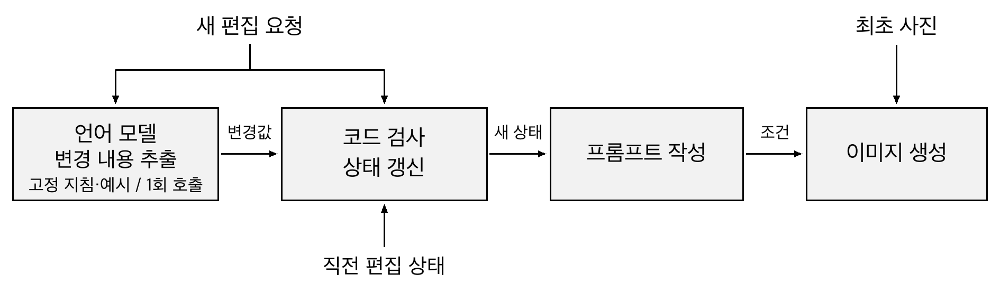
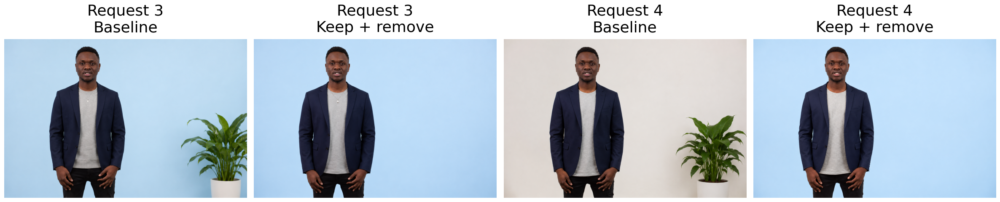
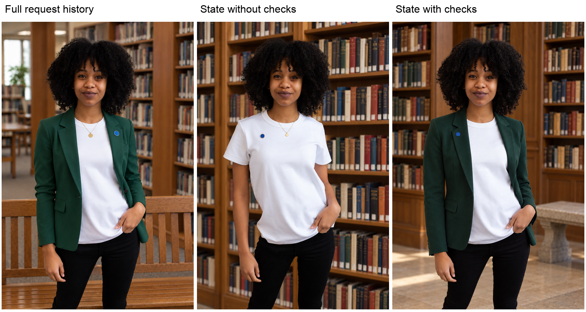

# 반복 인물 이미지 편집에서 지시 검사를 이용한 상태 갱신

State Updates Using Instruction Validation in Iterative Portrait Editing

저자: 김미르, 장윤석

지도교수: 안남혁

## 초록

반복 인물 이미지 편집에서는 새 요청을 반영하면서 앞서 지정한 조건을 유지하거나 취소해야 한다. 본 연구는 편집 조건을 항목별로 저장하고, 언어 모델이 한 번 추출한 변경 내용에 코드 검사를 적용하여 상태를 갱신하는 방법을 제안한다. 검사는 추출값의 유효성, 삭제·복원·유지의 적용 대상, 부정문·조건문·인용문의 실행 여부를 확인한다. 합성 영어 대화 12개의 요청 96개에서 동일한 최초 응답을 단순 적용한 방법과 비교하였다. 전체 상태 일치는 Qwen3-4B의 경우 52/96에서 96/96으로, Llama-3.2-3B-Instruct의 경우 27/96에서 93/96으로 증가하였다. 제안 방법은 요청당 한 번의 모델 호출로 상태를 갱신하였다. 실제 인물 사진 두 장과 대화 세 개에 적용한 이미지 18장에서는 전체 요청 이력 대신 검사 후 저장한 조건을 전달하여 마지막 프롬프트의 평균 길이를 204.00토큰에서 122.67토큰으로 줄였다. Qwen2.5-VL-7B의 편집 목표 충족 판정은 각각 34/36과 36/36이었으며 얼굴 보존 지표는 측정 항목에 따라 다른 양상을 보였다. 결과는 여섯 편집 항목과 지정한 영어 문형에서, 추출된 변경값을 요청의 동작과 적용 범위에 따라 검사하는 방식의 효과를 보여준다.

주요어: 반복 인물 이미지 편집, 상태 갱신, 지시 검사, 프롬프트 작성

## Abstract

Iterative portrait editing requires updating new requests while preserving or cancelling earlier conditions. We propose a method that stores editing conditions by attribute and validates changes extracted in a single language-model call. The checks cover value validity, the targets of removal, restoration and preservation, and whether negated, conditional or quoted instructions should be executed. We evaluated 96 synthetic English requests in twelve dialogues by reusing the same initial model responses across methods. Compared with directly applying those responses, the proposed method increased exact state matches from 52/96 to 96/96 for Qwen3-4B and from 27/96 to 93/96 for Llama-3.2-3B-Instruct. Each state update required one model call. A comparison of eighteen images generated from two real-person photographs and three dialogues reduced the mean final prompt length from 204.00 to 122.67 tokens by replacing full request histories with validated stored conditions. A post-hoc Qwen2.5-VL-7B evaluation found 34/36 satisfied target attributes for full histories and 36/36 for validated conditions. Facial preservation metrics varied across input methods. The results demonstrate the effect of checking extracted values against instruction actions and scope within six editing attributes, specified English forms and a predefined state-update policy.

## 1. 서론

자연어 지시를 이용한 이미지 편집은 사용자가 원하는 변화를 문장으로 입력하여 사진의 일부 속성을 수정하는 기술이다. InstructPix2Pix는 입력 이미지와 편집 지시를 함께 조건으로 사용하는 모델을 제시하였으며[1], ChatEdit는 얼굴 이미지 편집을 여러 차례의 대화로 확장하였다[2]. 대화를 통한 편집에서는 새로 추가한 요구와 앞서 지정한 조건이 함께 결과에 반영되어야 한다. 사용자가 의상이나 배경을 수정하는 동안 얼굴과 자세를 보존하고자 한다면, 변경할 속성과 유지할 속성을 구분하는 처리가 필요하다.

반복 요청은 같은 항목에 서로 다른 요구를 남길 수 있다. 은색 목걸이를 추가한 뒤 금색으로 바꾸고 다시 제거하도록 요청했다면 마지막 결과에는 목걸이가 없어야 한다. 반면 최초 사진의 모습으로 되돌리라는 요청은 원본에 있던 목걸이를 복원하는 의미이다. 이전 요청을 모두 전달하는 방식에서는 이미지 생성 모델이 이러한 변경 과정을 해석하여 마지막에 유효한 조건을 결정해야 한다. 마지막 요청만 전달하는 방식에서는 앞서 지정한 의상이나 배경이 누락될 수 있다.

입력 이미지의 선택도 반복 편집의 결과에 영향을 준다. 직전 출력을 다시 편집하면 출력에 생긴 얼굴이나 색상의 변화가 다음 입력에 포함된다. 최초 사진에 현재 조건을 적용하는 원본 기반 재생성은 매번 같은 이미지를 참조한다. ChatEdit도 원본 이미지를 편집하는 구조를 통해 오류 누적과 속성 망각을 다루었다[2]. 본 연구의 초기 합성 인물 실험에서 확인한 얼굴 보존 결과를 바탕으로, 원본을 재사용할 때 전달할 편집 조건을 정확하게 구성하는 문제를 연구 대상으로 삼았다.

이를 위해 재킷·상의·핀·목걸이·배경·소품의 값을 각각 저장하고, 새 요청이 들어올 때 해당 항목을 갱신한다. 이 항목과 값의 집합을 편집 상태라 정의한다. 편집 상태는 현재 요구를 직접 표현하지만, 언어 모델이 추출한 변경값을 잘못 저장하면 이후 요청에서도 오류가 이어진다. 예를 들어 목걸이 삭제를 원본 복원으로 해석하거나, 배경 유지 지시를 놓치면 저장된 조건이 사용자의 요구와 달라진다. 인용된 문장을 실제 편집 지시로 적용하는 경우도 같은 문제를 일으킨다.

본 연구는 언어 모델의 변경값 추출과 프로그램의 상태 갱신을 분리한다. 모델은 새 요청에서 변경할 항목과 값을 한 번 추출하고, 프로그램은 그 값의 유효성과 요청의 동작·적용 범위를 검사한다. 삭제·원본 복원·유지를 서로 다른 처리로 정의하고, 부정문·조건문·명시된 인용문을 즉시 실행할 지시와 구분한다. 갱신된 상태는 현재 조건만 포함한 프롬프트로 변환하여 최초 사진에 적용한다.

연구의 주된 검증 대상은 동일한 추출 응답에 코드 검사를 적용했을 때의 상태 정확도이다. 두 언어 모델에 같은 합성 요청 96개를 입력하고, 첫 응답의 단순 적용, 한 차례 재검토, 지시 검사의 조합을 비교한다. 실제 인물 사진에서는 전체 요청 이력과 저장된 조건을 각각 전달하여 입력 길이와 편집 목표 충족을 분석한다. 이 구성으로 요청 해석 후의 상태 갱신 효과와 이미지 생성 단계의 결과를 연결한다.

2장에서는 자연어 이미지 편집과 대화 상태 갱신에 관한 연구를 살펴본다. 3장은 제안 방법의 처리 절차, 4장은 비교 조건과 평가 지표를 설명한다. 5장은 상태 갱신 및 이미지 비교 결과를 제시하고, 6장과 7장은 결과의 해석과 결론을 기술한다.

## 2. 관련 연구

### 2.1 자연어 지시를 이용한 이미지 편집

InstructPix2Pix는 입력 이미지와 편집 지시를 조건으로 수정된 이미지를 생성하는 확산 모델이다[1]. 언어 모델과 이미지 생성 모델을 이용해 편집 예제를 합성하고, 이를 바탕으로 지시에 따른 이미지 변환을 학습한다. 목표 이미지 전체를 새로 기술하는 대신 현재 이미지에 가할 변화를 문장으로 지정한다는 점에서 대화형 편집의 기반이 된다.

MagicBrush는 원본 이미지, 편집 지시, 목표 이미지로 구성된 수작업 주석 자료를 제시하였다[3]. 한 차례의 편집과 여러 차례 이어지는 편집을 포함하여 자연어 요청에 따른 이미지 변화를 평가한다. 이러한 편집 과제에서는 지시한 변화의 반영과 원본 내용의 보존이 함께 고려된다. 의상을 바꾸는 요청을 충족하더라도 얼굴이 달라질 수 있으므로, 요청 충족과 얼굴 보존은 별도의 기준으로 측정할 필요가 있다.

이미지 편집 모델에 전달하는 지시는 단일 변경 문장일 수도 있고, 여러 요청을 반영한 최종 조건일 수도 있다. 여러 요청이 누적되면 어느 값을 현재 조건으로 사용할지 결정하는 단계가 추가된다. 본 연구는 이 입력 구성 과정에 초점을 두며, 같은 원본 사진에 전달하는 조건의 정확성과 길이를 평가한다.

### 2.2 대화를 이용한 얼굴 이미지 편집

ChatEdit는 얼굴 이미지 편집을 위한 대화 자료와 대화 처리 및 이미지 편집 모듈을 제안하였다[2]. 대화 처리 모듈은 전체 이력에서 현재 요구를 추적하고 응답을 생성하며, 이미지 편집 모듈은 추적한 요구를 최초 이미지에 적용한다. 최초 이미지를 재사용하는 설계는 반복 편집 중의 오류 누적과 속성 망각을 다루기 위한 것이다.

대화의 요구를 추적한 뒤 원본을 편집하는 구조에서는, 생성 모듈에 전달할 조건이 정확해야 한다. 특히 같은 항목을 여러 번 바꾸는 대화는 마지막 변경값뿐 아니라 앞선 값을 유지하는지, 제거하는지, 원본으로 되돌리는지도 구분해야 한다. 예를 들어 ‘목걸이 없음’과 ‘원본 목걸이’는 원본 사진에 목걸이가 있는 경우 서로 다른 조건이다.

본 연구는 원본 기반 편집 구조 안에서 변경값을 저장하는 절차를 구체화한다. 지정한 항목의 상태를 명시적으로 유지하고, 추출 응답에 지시 검사를 적용한 경우와 단순 적용한 경우를 비교한다. 이를 통해 어느 요청에서 어떤 항목이 달라졌는지 상태 수준에서 확인하고, 그 상태를 이용한 생성 결과를 분석한다.

### 2.3 항목별 대화 상태 갱신

대화 상태 추적은 대화에 나타난 사용자의 목표를 항목과 값으로 유지하는 과제이다. SOM-DST는 대화 상태를 고정된 크기의 메모리로 표현하고, 항목별 갱신 동작을 예측한 뒤 필요한 값만 생성하는 방법을 제안하였다[4]. 전체 상태를 매번 새로 생성하는 대신 변경할 부분을 선택하는 구조이며, 갱신 동작의 정확도가 상태 추적 성능에 미치는 영향을 분석하였다.

인물 편집에서도 새 요청이 지정한 속성은 바꾸고 나머지는 유지해야 한다. 다만 편집 상태에는 최초 사진을 참조하는 원본 복원과 직전 저장값을 참조하는 유지가 함께 존재한다. 따라서 값의 추출과 함께 참조 시점 및 적용 대상을 정해야 한다. “목걸이를 원본으로 돌리되 배경은 유지하라”는 요청에서는 복원과 유지가 서로 다른 항목에 적용된다.

본 연구는 선택적 상태 갱신의 관점에서 언어 모델이 변경할 항목만 추출하도록 구성한다. 이후 코드가 허용된 값과 요청의 어휘를 확인하고, 삭제·복원·유지의 대상을 검사한다. 상태 표현과 검사 범위를 여섯 편집 항목으로 정하여, 값 추출과 상태 반영 과정에서 발생한 오류를 추적한다.

### 2.4 언어 모델 응답의 재검토

Self-Refine은 모델이 생성한 첫 응답에 대해 스스로 피드백을 만들고 이를 이용해 응답을 반복 수정하는 방법이다[5]. 추가 학습 없이 생성·피드백·수정을 수행하며 여러 언어 과제에서 응답 개선을 평가하였다. 첫 응답에 오류가 있을 때 재검토를 이용하는 접근은 편집 상태 추출에도 적용할 수 있다.

상태 갱신에서 재검토 응답을 채택하면 잘못된 값을 고칠 수 있지만, 처음에 올바르게 추출한 항목이 누락될 수도 있다. 어느 응답을 저장할지 선택하는 과정이 이후 상태에 영향을 주므로, 호출 횟수와 응답 적용 방식을 함께 비교해야 한다. 본 연구의 재검토 조건은 새 요청과 최초 추출 결과를 다시 입력하여 수정된 JSON을 얻는 한 차례의 절차이다. 같은 최초 응답과 재검토 응답을 비교 조건들이 공유하도록 하여 응답 선택과 코드 검사의 영향을 분석한다.

이상의 연구를 바탕으로, 본 연구는 반복 인물 편집의 입력을 구성하는 과정에서 추출값과 실행할 지시의 관계를 검증한다. 원본 기반 생성과 항목별 상태 저장을 사용하고, 그 사이의 갱신 단계에 값 검증과 지시 적용 범위 검사를 결합하는 것이 제안 방법의 중심이다.

## 3. 제안 방법

### 3.1 편집 상태와 전체 처리 구조

편집 상태는 재킷·상의·핀·목걸이·배경·소품의 여섯 항목으로 구성한다. 각 항목은 미리 정한 속성값 또는 ‘원본’을 가지며, 제거 가능한 항목에는 ‘없음’을 허용한다. ‘원본’은 최초 사진에 나타난 모습, ‘없음’은 대상의 부재를 뜻한다. 처음에는 모든 항목을 ‘원본’으로 설정하고 요청을 처리할 때마다 상태를 갱신한다.

그림 1은 전체 처리 구조이다. 언어 모델에는 새 요청과 고정된 지침·예시를 입력한다. 모델은 변경할 항목과 값을 JSON으로 반환한다. 직전 편집 상태는 코드 검사 단계에서 참조하며, 모델의 입력에는 포함하지 않는다. 프로그램은 요청에 대한 추출 응답을 검사하여 상태를 갱신하고, 그 결과를 이미지 생성 프롬프트로 변환한다.

### 3.2 추출값과 지시 적용 범위의 검사

프로그램은 지원 문형을 정규화한 요청을 검사에 사용한다. 추출 응답의 중복 키, 항목 이름, 허용값과 요청 내 근거 어휘를 확인한다. 직전 값과 같은 변경은 제외하며, 남은 변경 중 하나라도 유효하지 않으면 해당 응답 전체를 적용하지 않는다. 사용할 수 있는 응답의 변경 내용을 직전 상태의 사본에 반영한 뒤, 삭제·원본 복원·유지 및 실행 대상 규칙을 적용한다. 응답이 거부된 경우에도 이 규칙으로 확인한 지시는 처리한다.

삭제는 대상을 ‘없음’으로, 원본 복원은 ‘원본’으로 바꾼다. 유지는 모델의 추출값을 적용하기 전의 상태를 보존한다. 이 처리는 요청의 동사와 항목 이름을 대응시켜 수행한다. 예를 들어 목걸이 삭제와 배경 유지가 함께 등장하면 목걸이만 제거하고 직전 배경을 남긴다. keep the necklace off처럼 부재를 지정한 구절은 단순 유지와 구분한다.

하나의 문장에 여러 동작이 있으면 지시 구절을 분리한다. 복원 지시 뒤의 leaving·preserving 구절을 유지 지시로 해석하고, 지원하는 bring back 및 source photo 표현을 표준 복원 표현으로 바꾼다. 이를 구절 정규화라 한다. 적용 범위가 명확한 어휘와 문형을 대상으로 하며, 인용부호가 포함된 요청은 인용 내용의 변형을 피하도록 이 정규화를 생략한다.

마지막으로 부정문, if를 포함한 조건문, 캡션이나 인용문으로 명시된 부분을 검사한다. 항목의 마지막 언급이 해당 범위에 있으면 직전 값을 보존한다. 같은 항목의 직접 지시가 그 뒤에 나오면 직접 지시를 따른다. 부정 구절의 범위는 다음 동작 지시가 시작되는 곳에서 끝난다. 조건문은 조건의 충족 여부와 관계없이 즉시 실행을 보류하도록 정의하였다. 유지 지시도 직전 저장값을 기준으로 처리하며, 유지 구절에 속성값이 함께 쓰여 있어도 직전 값을 우선한다. 이 두 규칙은 본 실험에서 사용하는 상태 갱신 정책이다.

### 3.3 실제 요청의 처리 예

96개 요청의 검증 자료에서 다음 요청에 대한 Qwen3의 응답을 살펴본다. 요청은 ‘Quoted text: "Restore the beige blazer". Keep the garden background unchanged.’이며, 직전 상태에는 베이지색 재킷과 정원 배경이 저장되어 있었다. 모델은 재킷을 ‘원본’, 배경을 ‘유지’로 추출하였다. 이 응답을 단순 적용하면 인용된 복원 문장 때문에 재킷이 원본으로 바뀐다.

제안 방법은 재킷의 마지막 언급이 명시된 인용 범위에 있음을 확인하여 직전 값인 베이지색을 보존한다. 배경은 직접적인 유지 지시에 따라 정원으로 남는다. 상의·핀·목걸이·소품도 직전 값을 이어받아 여섯 항목이 모두 정답과 일치하였다. 이 사례는 추출 응답의 형식이 올바르더라도 실제로 실행할 지시인지 확인하는 과정이 필요함을 보여준다.

### 3.4 응답 선택과 이미지 생성

비교 실험에서는 첫 응답만 사용하는 조건과 한 차례 재검토한 응답을 우선 사용하는 조건을 구성한다. 재검토를 사용하는 경우에는 재검토 응답을 먼저 검사하고, 사용할 수 없으면 최초 응답을 확인한다. 두 응답의 값을 합치는 방식이 아니라 응답 후보의 선택 순서를 달리한 비교이다. 제안 방법은 최초 응답 하나에 값 검증과 지시 검사를 적용하므로 요청당 모델 호출 한 번이 필요하다.

최종 프롬프트에는 항목별로 저장한 현재 조건을 적고, 얼굴·표정·자세·인물 조명·카메라 구도를 보존하도록 공통 문구를 붙인다. ‘원본’인 항목은 최초 사진의 모습을 따르도록 기술한다. 이미지 생성에는 이 프롬프트와 최초 사진을 함께 전달한다. 따라서 앞선 요청에서 취소되거나 대체된 값은 다음 생성의 입력에 남지 않는다.

## 4. 실험 설계

### 4.1 비교 조건과 실험 자료

주 실험은 동일한 추출 응답에 대한 상태 갱신 방식을 비교한다. 첫 응답 단순 적용, 재검토 응답 우선 적용, 추출·재검토와 검사 결합, 한 번 추출과 검사 결합의 네 조건을 사용하였다. Qwen3-4B와 Llama-3.2-3B-Instruct[6,7]의 4비트 양자화 모델에 온도 0, 최대 출력 260토큰, 공통 예시 7개를 적용하였다. 비교 조건들은 저장된 최초·재검토 응답을 공유하고, 각 조건에서 갱신한 상태를 다음 요청으로 이어갔다.

자료는 AI를 이용해 작성한 합성 영어 대화 12개이며, 대화마다 요청 여덟 개를 순서대로 적용하여 총 96개를 평가하였다. 네 가지 표현 틀에 세 가지 속성 조합을 배정하고 초기 설정, 두 항목 변경, 삭제·유지, 복원·유지, 부정 지시, 인용문, 조건문, 인용문 뒤의 직접 지시를 포함하였다. 중간 요청의 순서도 달리하였다. 개발 후 코드·모델 설정·검증 요청·정답을 고정하였으며, 검증 문장은 기존 자료와 중복되지 않는다.

정답은 대화 작성 시 정한 항목별 변경을 초기 상태에 차례로 적용하여 구성하였다. 조건문 보류, 인용문 및 부정 지시의 실행 제외, 직전 값 유지의 정책은 3장의 정의를 따른다. 따라서 전체 상태 일치는 이 정책에 따라 계산한 정답과의 일치이다. 정답은 채점에만 사용하고, 두 모델에 동일한 96개 요청을 각각 입력하여 최초·재검토 응답 384개를 저장하였다. 앞선 기본 검증에는 별도의 세 대화, 요청 12개를 사용하였다.

지시 검사 구성요소의 효과는 유지·삭제, 구절 분리, 복원 표현, 실행 대상 검사에 관한 기존 비교에서 분석하였다. 각 비교는 해당 단계의 구현을 고정한 뒤 별도의 대화에 적용하였다. 문장 구조 비교의 요청 36개는 고유 문장 18개, 표현과 순서 변경의 요청 48개는 고유 문장 32개를 포함한다. 표정·포즈 실험은 별도 구현으로 몸 방향·손동작·표정을 더한 아홉 항목을 평가하였다. 요청 조건 세 종류와 목표 구성 네 개에 요청을 네 개씩 적용한 48개이며, Qwen3-4B에 온도 0, 최대 출력 320토큰과 공통 예시 두 개를 사용하였다.

입력 이미지 선택의 근거로는 합성 인물 6명에게 같은 10단계 편집을 적용한 초기 자료를 사용하였다. 순차 편집은 직전 출력을 입력으로 사용하고, 원본 기반 방식은 최초 사진에 같은 최종 요구를 적용하였다. 얼굴·표정·자세·인물 조명은 유지하도록 요청하였다. 크기 1024×1536의 순차 출력 60장과 원본 기반 최종 출력 6장을 비교하였다.

실제 인물 사진은 Pexels에 공개된 Monstera Production의 두 장이다[8,9]. R01과 R02를 각각 512×336, 512×768 크기로 입력하였다. 기존 세 대화의 마지막 요청에 대해 전체 요청 이력, 검사 없이 저장한 조건, 검사 후 저장한 조건을 구성하여 총 18장을 생성하였다. 두 상태 조건은 같은 Qwen3 최초 응답을 사용하였다. 모든 조건은 최초 사진에서 생성하였고 조건별로 정상 생성된 첫 이미지를 사용하였다. 이미지는 내장 imagegen 도구로 생성하였으며, 내부 모델 버전과 시드는 노출되지 않았다.

보조 이미지 비교는 유지·삭제 규칙의 요청 32개에 인물 두 명과 두 방법을 적용한 128조건이다. 같은 원본과 프롬프트는 이미지를 공유하여 실제 출력은 66장이며, 방법 간 64쌍 중 입력이 다른 경우는 4쌍이다.

### 4.2 평가 지표

전체 상태 일치율은 요청 처리 후 평가 대상 항목이 모두 정답과 일치한 요청의 비율이다. 주 실험은 여섯 항목, 표정·포즈 실험은 아홉 항목을 평가한다. 항목별 일치율은 전체 평가 항목 중 정답과 일치한 비율, 최종 상태 일치율은 마지막 요청에서 모든 항목이 맞은 대화의 비율이다. 유지 위반은 직전까지 맞았고 현재 요청에서도 보존해야 하는 값을 잘못 바꾼 횟수이다. 표에는 일치 건수와 평가 건수를 함께 표시하였다.

같은 대화의 요청들은 앞선 상태를 이어받으므로 대화 12개를 단위로 정확도 차이를 분석하였다. 대화를 20000회 복원 추출하여 95% 백분위 구간을 계산하고, 대화별 차이의 4096개 부호 조합을 이용한 양측 무작위화 검정을 수행하였다. 첫 응답 단순 적용과 제안 방법의 비교에 대해 두 모델의 p값에 Holm 보정을 적용하였다. 이 구간과 검정은 표현 틀을 공유하는 합성 자료 안의 변동을 나타낸다.

초기 얼굴 비교에는 원본에서 정한 320×360 영역의 평균절대오차(MAE), 구조적 유사도(SSIM), 심층 특징 기반 지각적 거리(LPIPS)[10]를 사용하였다. 원본과 출력의 위치 차이는 정규화 상호상관(NCC)으로 ±64픽셀 범위에서 찾고, 평활화 sigma 3을 적용하였다. sigma 1과 6도 함께 확인하였다. MAE와 LPIPS는 낮을수록, SSIM은 높을수록 원본에 가깝다. 실제 인물의 얼굴 코사인 유사도는 InsightFace buffalo_l[11]로 측정하였고 높을수록 특징이 유사하다. 후속 이미지 18장은 얼굴 랜드마크로 각각 112×112에 정렬한 뒤 MAE, SSIM, LPIPS를 계산하였다. 두 이미지 실험은 얼굴 영역과 전처리가 다르므로 각각 해석한다.

편집 목표는 Qwen2.5-VL-3B의 4비트 모델[12]이 성공·실패·판단 불가로 한 번 평가하였다. 이미지와 여섯 목표를 입력하고 생성 방식과 프롬프트는 제공하지 않았다. 형식 오류와 판독 불가는 분모에 포함하되 성공으로 집계하지 않았다. 3B 응답의 오류를 관찰한 뒤 같은 이미지·목표 전체를 Qwen2.5-VL-7B로 사후 평가하였다. 두 평가의 원문과 점수는 각각 기록하였다.

프롬프트 길이는 공통 보존 문구를 포함한 문자열의 문자 수·단어 수·고정 Qwen3 토크나이저의 토큰 수로 측정하였다. 세 대화에서 요청이 추가될 때마다 총 12개 묶음을 비교하였다. 모델 호출 수는 상태 갱신에 필요한 횟수이다.

### 4.3 재현 자료

요청·정답·모델 응답, 생성 이미지, 실행 설정과 비교별 상세 결과는 연구 저장소에 공개하였다. 코드로 구성한 상태 검사 1323개를 수행하고, 기존 저장 응답 24개 및 주 검증의 첫 응답 192개를 실제 실행 코드에 재생하여 실험 구현과 대조하였다. 이 검사는 구현의 일치 여부를 확인한 것이다.

https://github.com/kimmireu0220/inha-capstone

## 5. 실험 결과

### 5.1 상태 갱신의 정확도

표 1은 96개 요청에서 응답 선택과 지시 검사 적용 여부를 비교한 결과이다. 첫 응답을 단순 적용하면 Qwen3는 52/96, Llama는 27/96이었으며, 같은 최초 응답에 검사를 적용한 제안 방법은 각각 96/96과 93/96이었다. 별도의 기본 검증 요청 12개에서도 첫 응답 단순 적용은 두 모델 모두 3/12, 제안 방법은 모두 12/12였다.

| 방법 | 요청당 호출 수 | Qwen3-4B | Llama-3.2-3B |
| --- | --- | --- | --- |
| 첫 응답만 적용 | 1 | 52/96 | 27/96 |
| 재검토 응답 우선 | 2 | 48/96 | 9/96 |
| 추출·재검토+검사 | 2 | 96/96 | 44/96 |
| 한 번 추출+검사 | 1 | 96/96 | 93/96 |

제안 방법의 항목별 일치는 Qwen3 576/576, Llama 573/576이며 최종 상태 일치는 각각 12/12와 9/12였다. 첫 응답 단순 적용 대비 정확도 차이는 Qwen3 45.83%p, Llama 68.75%p였다. 대화 단위 95% 구간은 각각 31.25–59.38%p와 62.50–75.00%p이며, Holm 보정 p값은 각각 0.001953과 0.000977이었다.

재검토 응답을 우선 적용하면 첫 응답 단순 적용보다 일치 건수가 줄었다. 검사를 결합한 경우에도 Llama의 추출·재검토 조건은 44/96으로, 최초 응답에만 검사를 적용한 93/96보다 낮았다. Qwen3는 두 검사 조건이 모두 96/96이었다. 이 비교에서 호출을 한 번 더 사용하는 것보다 어떤 응답에 검사를 적용하는지가 결과에 영향을 주었다.

### 5.2 요청 유형과 오류 원인

표 2는 요청 유형별 전체 상태 일치 결과이다. 초기 설정은 두 모델의 첫 응답이 모두 맞았지만, 여러 항목을 변경하거나 실행할 지시를 구분하는 후속 요청에서는 단순 적용의 오류가 나타났다. 제안 방법은 Qwen3의 모든 유형에서 정답과 일치하였고, Llama에서는 인용문 뒤에 직접 지시가 오는 유형의 오류 세 개가 남았다.

| 요청 유형 | Qwen3 단순 | Qwen3 검사 | Llama 단순 | Llama 검사 |
| --- | --- | --- | --- | --- |
| 초기 설정 | 12/12 | 12/12 | 12/12 | 12/12 |
| 두 항목 변경 | 3/12 | 12/12 | 1/12 | 12/12 |
| 삭제·유지 | 6/12 | 12/12 | 5/12 | 12/12 |
| 복원·유지 | 9/12 | 12/12 | 2/12 | 12/12 |
| 부정 지시 | 10/12 | 12/12 | 5/12 | 12/12 |
| 인용문 | 5/12 | 12/12 | 1/12 | 12/12 |
| 조건문 | 2/12 | 12/12 | 0/12 | 12/12 |
| 인용문 뒤의 직접 지시 | 5/12 | 12/12 | 1/12 | 9/12 |

Llama의 세 오류는 같은 표현 틀의 마지막 요청에서 발생하였다. 인용문 뒤에 재킷을 원본 사진의 모습으로 복원하라고 직접 지시했으나 모델은 녹색으로 추출하였다. 검사는 요청에 근거가 없는 색 변경을 거부하였다. 해당 요청은 인용부호가 포함되어 구절 정규화가 생략되었고, 뒤에 나온 복원 표현도 기존 규칙에서 처리하지 못하였다. 그 결과 직전 재킷 값이 남았으며 세 대화의 최종 상태도 정답과 달랐다. 이는 잘못된 변경값을 거부하는 처리와 올바른 복원값을 결정하는 처리가 모두 필요함을 보여준다.

유지와 삭제의 역할은 요청 32개의 구성요소 비교에서 확인하였다(표 3). 기준 방법은 추출·재검토 응답에 값 검증과 원본 복원 처리를 적용한 기존 구현이며, 이 구현에서 유지·삭제 규칙의 적용 여부만 달리하였다. 삭제 규칙은 식물 제거 누락을 바로잡았고, 유지 규칙은 보존할 배경까지 원본으로 바뀌는 오류를 막았다. 두 규칙을 결합했을 때 한 대화의 두 요청이 추가로 정답과 일치하였다.

| 방법 | 전체 상태 일치율 | 항목별 일치율 | 최종 상태 일치율 | 유지 위반 수 |
| --- | --- | --- | --- | --- |
| 기준 방법 | 27/32 | 184/192 | 6/8 | 1 |
| 유지 규칙만 | 27/32 | 185/192 | 6/8 | 0 |
| 삭제 규칙만 | 28/32 | 186/192 | 6/8 | 1 |
| 유지·삭제 결합 | 29/32 | 187/192 | 7/8 | 0 |

복원 표현의 적용 범위도 결과에 영향을 주었다. 구절을 분리한 비교에서는 Qwen3의 일치 건수가 9/16에서 16/16으로 증가하였지만, 표현과 순서를 바꾼 검증에서 기존 규칙에 없는 복원 표현은 0/8이었다. 복원 표현을 확장한 뒤 별도의 요청 32개에 적용한 결과는 Qwen3 14/32에서 28/32, Llama 7/32에서 17/32였다. 문장 구조를 분리하는 처리와 지원 어휘의 범위가 함께 작용한 결과이다.

실행 대상 검사 검증에서 Qwen3는 조건문·인용문을 실제 명령으로 적용하는 오류가 줄어 9/16에서 16/16으로 증가하였다. 같은 검증의 Llama는 검사 전후 모두 0/16이었다. 최초 응답이 맞혔던 초기 설정을 재검토 응답이 일부 항목만 남겨 반환하면서 후속 상태까지 오류가 이어졌다. 이러한 응답 선택의 영향은 표 1의 한 번 추출 조건을 비교하게 된 근거이다.

표정·포즈를 포함한 요청 48개에서는 표정만 지정한 조건과 표정·포즈 조건이 각각 모든 방법에서 16/16이었다. 삭제·복원 등의 속성 지시를 섞은 조건은 최초 추출과 재검토가 각각 4/16, 규칙 보정은 16/16이었고 항목별 일치는 각각 124/144, 124/144, 144/144였다. 삭제 규칙만 적용한 사후 재계산도 요청 48개가 모두 일치하였다. 포즈를 제외한 짧은 대조 요청 8개에서는 최초 추출과 재검토가 각각 7/8이었다. 관찰한 오류는 포즈값의 추출보다 삭제를 원본 복원으로 처리한 부분에 집중되었다. 정답 조건을 입력해 생성한 이미지 6장의 AI 평가에는 형식 오류 두 개와 몸 방향의 설명·점수 불일치가 있었다.

### 5.3 입력 이미지 선택과 유지 및 삭제의 적용

초기 합성 인물 실험에서 순차 편집의 위치 보정 LPIPS 평균은 1단계 0.042116, 5단계 0.173505, 10단계 0.364015였다. 동일한 최종 요구를 적용한 원본 기반 재생성은 위치 보정 MAE, SSIM, LPIPS 모두 6/6쌍에서 순차 편집보다 원본에 가까웠다. 보정 전에는 각 지표가 5/6쌍에서 같은 방향이었으며, sigma 1과 6에서도 보정 후 방향이 유지되었다. 이 비교를 바탕으로 후속 생성에는 최초 사진과 현재 조건을 사용하는 구성을 채택하였다.

그림 2는 표 3의 기준 방법과 유지·삭제 결합을 실제 인물 R01에 적용한 사례이다. 세 번째 요청에서는 기준 출력에 남은 식물이 규칙 결합 출력에서 사라지고, 네 번째 요청에서는 앞서 정한 파란 배경이 유지된다. 각 방법의 64조건에서 여섯 목표를 평가한 결과는 3B 기준 350/384와 결합 358/384, 7B 기준 372/384와 결합 374/384였다. 판단 불가는 3B에서 각각 20개와 13개, 7B에서 모두 0개였다.

3B에서 증가한 성공 항목 8개 중 6개는 판단 불가에서, 2개는 실패에서 바뀌었다. 7B에서도 설명과 점수가 모순된 응답이 있었으며, 두 평가에서 공통으로 실패에서 성공으로 바뀐 항목은 R02의 배경 한 개였다. 얼굴 코사인 평균은 기준 0.910458, 결합 0.910535였고 입력이 다른 네 쌍 중 두 쌍에서 증가하고 두 쌍에서 감소하였다. 이 사례는 상태 보정이 생성 조건을 바꾸는 과정을 보여주며, 이미지 집계에는 입력이 같은 쌍도 포함되어 있다.

### 5.4 프롬프트 길이와 편집 목표 충족

표 4는 세 대화의 마지막 요청에서 측정한 입력 길이이다. 검사 후 저장한 조건은 전체 요청 이력보다 평균 토큰 수가 39.87% 적었다. 중간 요청을 포함한 12개 묶음의 평균은 전체 이력 168.75토큰, 검사 후 조건 129.25토큰이었다. 첫 요청에서는 항목을 명시한 상태 표현이 더 길었으나, 두 번째 요청부터 세 대화 모두 저장한 조건을 전달하는 방식이 짧았다.

| 입력 방식 | 평균 문자 수 | 평균 단어 수 | 평균 토큰 수 |
| --- | --- | --- | --- |
| 전체 요청 이력 | 958.67 | 156.33 | 204.00 |
| 검사 없이 저장한 조건 | 624.33 | 101.33 | 133.33 |
| 검사 후 저장한 조건 | 581.00 | 93.67 | 122.67 |

표 5는 세 입력 방식으로 생성한 18장의 편집 목표 충족 판정이다. 각 방식의 분모 36은 인물 두 명과 대화 세 개의 이미지 여섯 장에서 여섯 목표를 평가한 항목 수이다. 7B 평가에서 검사 후 조건은 전체 이력보다 성공 항목이 두 개 많았고, 검사 없이 저장한 조건보다 열두 개 많았다.

| 입력 방식 | 3B 충족 | 판단 불가 | 7B 충족 | 판단 불가 |
| --- | --- | --- | --- | --- |
| 전체 요청 이력 | 29/36 | 6 | 34/36 | 0 |
| 검사 없이 저장한 조건 | 18/36 | 18 | 24/36 | 2 |
| 검사 후 저장한 조건 | 30/36 | 6 | 36/36 | 0 |

3B 평가에는 형식 오류 5개와, 회색 스웨터·금색 핀을 흰 상의·핀 없음으로 설명한 사례가 있었다. 3B와 7B의 전체 점수 일치는 75/108, 양쪽이 성공·실패를 반환한 항목의 일치는 73/78이었다. 표 5는 이 판독 차이를 포함한 두 평가의 결과를 제시한다.

### 5.5 얼굴 보존과 생성 사례

후속 이미지 18장에서 얼굴은 모두 하나씩 검출되었다. 표 6은 각 방식의 첫 출력 여섯 장에 대한 얼굴 지표 평균이다. 검사 후 조건은 검사 없이 저장한 조건보다 코사인과 SSIM, LPIPS가 유리하고 MAE는 불리하였다. 전체 이력과 비교하면 코사인은 높았으나 MAE, SSIM, LPIPS는 불리하였다.

| 입력 방식 | 얼굴 코사인 | MAE | SSIM | LPIPS |
| --- | --- | --- | --- | --- |
| 전체 요청 이력 | 0.919842 | 0.072179 | 0.789038 | 0.095158 |
| 검사 없이 저장한 조건 | 0.901997 | 0.086795 | 0.748089 | 0.109213 |
| 검사 후 저장한 조건 | 0.923318 | 0.095572 | 0.754197 | 0.106698 |

그림 3은 조건문과 인용문을 포함한 대화를 R02에 적용한 예이다. 목표는 녹색 재킷, 파란 핀, 도서관과 돌 벤치를 적용하고 상의와 목걸이를 최초 사진의 모습으로 복원하는 것이다. 원본에는 흰 상의가 있고 목걸이는 없다. 검사 없이 저장한 조건에는 인용문의 재킷 복원과 조건부 벤치 삭제가 반영되었다. 검사 후에는 녹색 재킷과 벤치를 유지하였다. 표 4~6은 이 예와 나머지 두 대화를 모두 포함한다.

## 6. 논의

### 6.1 추출값의 저장과 오류의 전파

반복 편집에서는 한 요청의 잘못된 값이 다음 요청의 시작 상태가 된다. 이후 요청이 다른 항목만 바꾸면 이전 오류는 그대로 남는다. 이 때문에 전체 상태 정확도는 개별 요청의 추출 성능뿐 아니라 변경값을 채택하고 보존하는 절차에 영향을 받는다. 동일한 최초 응답을 사용한 주 비교는 값 검증과 지시 검사가 이러한 저장 오류를 줄였음을 보여준다.

유지와 원본 복원은 참조하는 시점이 다르다. 저장된 배경을 유지할 것인지 최초 사진의 배경으로 되돌릴 것인지를 구분하지 않으면, 유효한 속성값을 반환하더라도 잘못된 결과가 된다. 따라서 허용값 검사에 더해 동작과 대상의 관계를 확인해야 한다. 반대로 직전 값 자체가 틀렸다면 유지 규칙은 그 오류도 보존한다. 구성요소 비교의 사례들은 동작의 올바른 해석과 이전 상태의 정확성이 함께 필요함을 보여준다.

재검토는 응답을 교체하는 과정이므로 이미 맞은 항목을 잃을 가능성도 있다. 특히 초기 설정이 누락되면 이후 대화의 여러 요청이 영향을 받는다. 본 실험에서 최초 응답에 검사를 적용하는 방식이 Llama의 두 번 호출 조건보다 높은 정확도를 보인 것은, 호출 횟수의 증가가 상태 보존을 보장하지 않음을 보여준다. 다만 이는 본 연구의 한 차례 재검토 지침과 응답 선택 절차에서 얻은 결과이다.

### 6.2 상태 정확도와 이미지 생성의 관계

현재 조건을 저장하면 이미 취소되거나 대체된 값을 입력에서 제외할 수 있다. 프롬프트가 짧아지는 시점은 앞선 요청이 누적된 이후였으며, 첫 요청에서는 항목을 명시하는 문장이 오히려 더 길었다. 따라서 입력 길이 감소는 상태 표현 자체의 길이와 전체 이력의 증가가 함께 작용한 결과이다.

검사 없이 저장한 조건도 전체 이력보다 짧았지만 편집 목표의 성공 항목은 더 적었다. 이는 프롬프트를 간결하게 만드는 과정에서 잘못된 상태를 전달하면, 짧은 입력이 요청 충족으로 이어지지 않음을 보여준다. 제안 방법에서 지시 검사는 간결하게 전달할 조건의 정확성을 확보하는 역할을 한다.

얼굴 보존은 또 다른 측정 대상이다. 전체 이력과 검사 후 조건의 비교에서 얼굴 코사인과 MAE, SSIM, LPIPS는 서로 다른 방향을 보였다. 얼굴 코사인은 특징의 유사도, MAE는 픽셀 오차, SSIM과 LPIPS는 구조 및 지각적 차이를 측정하므로 각 지표의 방향을 함께 해석해야 한다. 초기 실험은 입력 이미지 선택의 근거이고, 후속 실험은 같은 원본에 전달하는 조건의 비교이다. 두 결과를 함께 보면 원본 재사용, 상태 정확도, 생성 이미지의 특성을 각각 평가해야 한다.

### 6.3 적용 범위와 평가의 해석

상태 갱신 평가는 여섯 항목과 네 가지 표현 틀로 구성한 합성 영어 대화를 대상으로 하였다. 요청마다 속성 조합과 지시 순서를 바꾸었지만 문장 구조는 공유한다. 따라서 대화 단위 구간과 검정은 이 자료에서의 방법 간 차이를 나타낸다. 조건문 보류와 직전 값 유지도 사전에 정의한 정책이다. 이 점수는 사전에 정의한 실행 정책에 따라 항목값을 갱신하고 보존하는지를 나타낸다.

Llama의 최종 세 오류는 추출값 검사가 잘못된 변경을 막은 뒤에도, 지원 문형에 포함되지 않은 복원 표현을 처리하지 못해 정답 상태에 도달하지 못한 사례이다. 이처럼 검사의 효과는 지원 어휘, 구절 분리, 지시 우선순위의 구현 범위에 의해 결정된다. 실험은 이 범위에서 같은 모델 응답을 어떻게 저장하는지가 정확도에 미치는 영향을 확인하였다.

실제 인물 비교는 두 사진과 세 대화의 여섯 대응 사례에 대한 첫 출력이다. AI 평가의 형식 오류와 설명·점수 불일치, 얼굴 지표 간 차이를 함께 관찰하였다. 따라서 생성 결과는 상태 갱신 방법을 이미지 편집에 적용한 사례와 기술통계로 해석한다. 연구의 직접적인 근거는 정답 상태와의 비교이며, 이미지 결과는 그 조건을 전달했을 때 나타난 변화를 설명한다.

## 7. 결론

본 연구는 반복 인물 이미지 편집에서 언어 모델의 변경값 추출과 코드에 의한 상태 갱신을 분리하는 방법을 제안하였다. 추출값의 유효성과 삭제·복원·유지의 적용 대상을 검사하고, 실행할 지시를 구분하여 항목별 상태를 갱신하였다. 갱신한 조건은 최초 사진에 적용할 프롬프트로 변환하였다.

새 합성 요청 96개에서 동일한 최초 응답을 단순 적용한 방법과 비교한 전체 상태 일치는 Qwen3 52/96에서 96/96, Llama 27/96에서 93/96으로 증가하였다. 요청당 한 번의 모델 호출을 사용하면서, 정의한 상태 갱신 정책에 대한 정확도를 높였다. 실제 인물 사진을 이용한 비교에서는 전체 요청 이력 대신 검사 후 저장한 조건을 전달하여 마지막 프롬프트의 평균 길이를 204.00토큰에서 122.67토큰으로 줄였다.

이 결과는 반복 편집 시스템에서 변경값을 추출한 뒤 어떤 조건을 보존하고 실행할지 검사하는 절차의 필요성을 보여준다. 편집 항목을 명시적으로 저장하고 지시의 동작·대상·적용 범위를 함께 확인하는 구성이, 누적 요청으로부터 현재 편집 조건을 만드는 구현 방법이 될 수 있다.

## 참고문헌

[1] T. Brooks, A. Holynski, and A. A. Efros, “InstructPix2Pix: Learning to Follow Image Editing Instructions,” CVPR, 2023. https://arxiv.org/abs/2211.09800

[2] X. Cui et al., “ChatEdit: Towards Multi-Turn Interactive Facial Image Editing via Dialogue,” EMNLP, pp. 14567–14583, 2023. https://aclanthology.org/2023.emnlp-main.899/

[3] K. Zhang et al., “MagicBrush: A Manually Annotated Dataset for Instruction-Guided Image Editing,” NeurIPS, vol. 36, 2023. https://papers.neurips.cc/paper_files/paper/2023/hash/64008fa30cba9b4d1ab1bd3bd3d57d61-Abstract-Datasets_and_Benchmarks.html

[4] S. Kim et al., “Efficient Dialogue State Tracking by Selectively Overwriting Memory,” ACL, pp. 567–582, 2020. https://aclanthology.org/2020.acl-main.53/

[5] A. Madaan et al., “Self-Refine: Iterative Refinement with Self-Feedback,” 2023. https://arxiv.org/abs/2303.17651

[6] A. Yang et al., “Qwen3 Technical Report,” arXiv:2505.09388, 2025. https://arxiv.org/abs/2505.09388

[7] Meta, “Llama 3.2 Model Card,” 2024. https://huggingface.co/meta-llama/Llama-3.2-3B-Instruct

[8] Monstera Production, “Confident black man in studio,” Pexels, photo 6311573. https://www.pexels.com/photo/confident-black-man-in-studio-6311573/

[9] Monstera Production, “Cheerful black woman in studio,” Pexels, photo 6311581. https://www.pexels.com/photo/cheerful-black-woman-in-studio-6311581/

[10] R. Zhang et al., “The Unreasonable Effectiveness of Deep Features as a Perceptual Metric,” CVPR, 2018. https://arxiv.org/abs/1801.03924

[11] InsightFace Contributors, “Model Zoo,” InsightFace. https://github.com/deepinsight/insightface/tree/master/model_zoo

[12] S. Bai et al., “Qwen2.5-VL Technical Report,” arXiv:2502.13923, 2025. https://arxiv.org/abs/2502.13923
